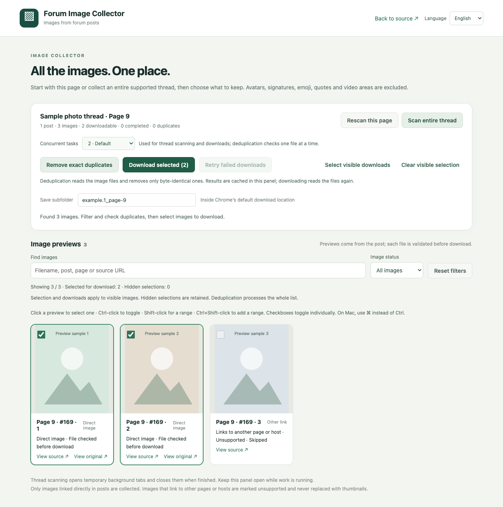

# Forum Image Collector

[简体中文](README.md) · English · [Troubleshooting](docs/TROUBLESHOOTING.md) · [Publishing](docs/PUBLISHING.md)

Collect images linked directly in forum posts, preview the results, and download the ones you choose. A local-first Chrome extension with Chinese and English interfaces and no account or upload service.



*The actual extension interface, rendered with synthetic test data. This is not a live-site compatibility demonstration.*

## What it does

- Switch between English and Simplified Chinese without restarting a scan or download. The first launch follows the browser language; an explicit choice is remembered locally.

- Collects post-body images, excluding known avatar, signature, quote, emoji and video containers.
- Scans all pages of compatible XenForo threads, with ordered results and in-panel resume.
- Collects only images linked directly in posts. Links to viewer pages, galleries or other hosts are marked unsupported and are never replaced with thumbnails.
- Filters previews by filename, post, page, source address or status.
- Supports checkboxes, Ctrl/Command toggles and Shift ranges. Selection and downloads apply to visible cards; hidden selections are retained.
- Retries selected visible download failures without resaving completed images.
- Optionally removes byte-identical duplicates using SHA-256, with 1–4 concurrent tasks (default 2).

## Install

Use Chrome 120+ on a desktop. Download the extension ZIP from this repository's Releases when available, or use the `extension/` directory in the source.

1. Extract the ZIP.
2. Open `chrome://extensions` and enable **Developer mode**.
3. Choose **Load unpacked** and select **extension**, the folder containing `manifest.json`.
4. Pin the extension, open a supported HTTPS forum thread, and click its icon.

Node.js and Python are only required for development. This project is not a Chrome Web Store listing. Preparing a repository does not publish a release.

## Workflow

Use **Language** in the top-right corner to switch English / 简体中文. Chinese browser locales default to Chinese; other locales default to English. Switching preserves filters, selection and running queues. Source titles, original filenames and save paths remain unchanged. Unknown browser/server diagnostics are shown as received.

**Collect → optionally deduplicate → filter/select → download.**

The current page is scanned first. For supported threads, choose “Scan entire thread”, then use the previews to choose what to keep. Downloads go under `帖子图片/<subfolder>/` in Chrome's default download location.

The extension requests access to the exact site origins needed when you click an action. A CDN can need a separate grant. After checking a failed source, use “Retry failed downloads” to retry only selected, visible download failures. Deduplication reads the image files; downloading reads them again.

Filtering does not alter collected data. **Selection, range selection, downloads and retry operate on visible cards.** Deduplication still processes the entire list. Filters are locked during work; starting a new current-page or full-thread scan resets them. Stop prevents new queued work; active tasks finish first.

Keep the panel open: lists, selections and scan progress are memory-only. Closing it loses them. There is no history check against files already on disk.

## Compatibility

| Layout | Supported scope |
| --- | --- |
| XenForo-style post bodies | Current page; full thread for supported `/threads/.../page-N` navigation |
| phpBB-style bodies | Images already loaded on the current page |
| Discourse-style bodies | Already-loaded posts; no automatic infinite scrolling |
| Direct images / attachments | HTTPS candidates, verified by MIME, decoding and size |

Matching is based on documented forum layouts, not a hostname allowlist, and there are no site-specific templates. **Not every forum is supported.** See [adapters](docs/ADAPTERS.md), [verification status](docs/VALIDATION.md) and [manual browser checks](docs/SMOKE_TEST.md).

## Development

Node.js 22+ and Python 3.11+:

```sh
npm ci --ignore-scripts
npm run verify
python3 -m unittest discover -s tests -p 'test_*.py'
python3 tools/package.py
```

On Windows use `python` (or `py -3`) if `python3` is unavailable. On macOS, `bash tools/mac-check.sh` runs these checks; `PYTHON_BIN` can point to another Python executable.

The runtime is plain Manifest V3 JavaScript, without a bundler or runtime npm dependencies. Tests use synthetic DOM fixtures and Chrome API doubles. CI is configured for Linux, macOS and Windows; this is not a claim that hosted CI has already run. ZIPs in `dist/` include the extension, clean source, Mac handoff and SHA-256 checksums. Packaging uses an explicit file list and stable ZIP metadata.

[Contributing](CONTRIBUTING.md) · [Architecture](docs/ARCHITECTURE.md) · [Changelog](CHANGELOG.md) · [Privacy](docs/PRIVACY.md) · [Security](SECURITY.md)

## About this project

Most of the code was written with the help of AI coding assistants. I defined the requirements and usage boundaries and verified the behavior.

## Privacy and license

No telemetry, remote code or upload service. Website requests can use your existing login session; source sites still see traffic. The extension does not bypass login or access restrictions. See the [permission details](docs/PRIVACY.md).

[MIT](LICENSE), retained from the supplied project. Future work—persistent resume, visual-similarity deduplication, additional pagination adapters—is not included in this release.
