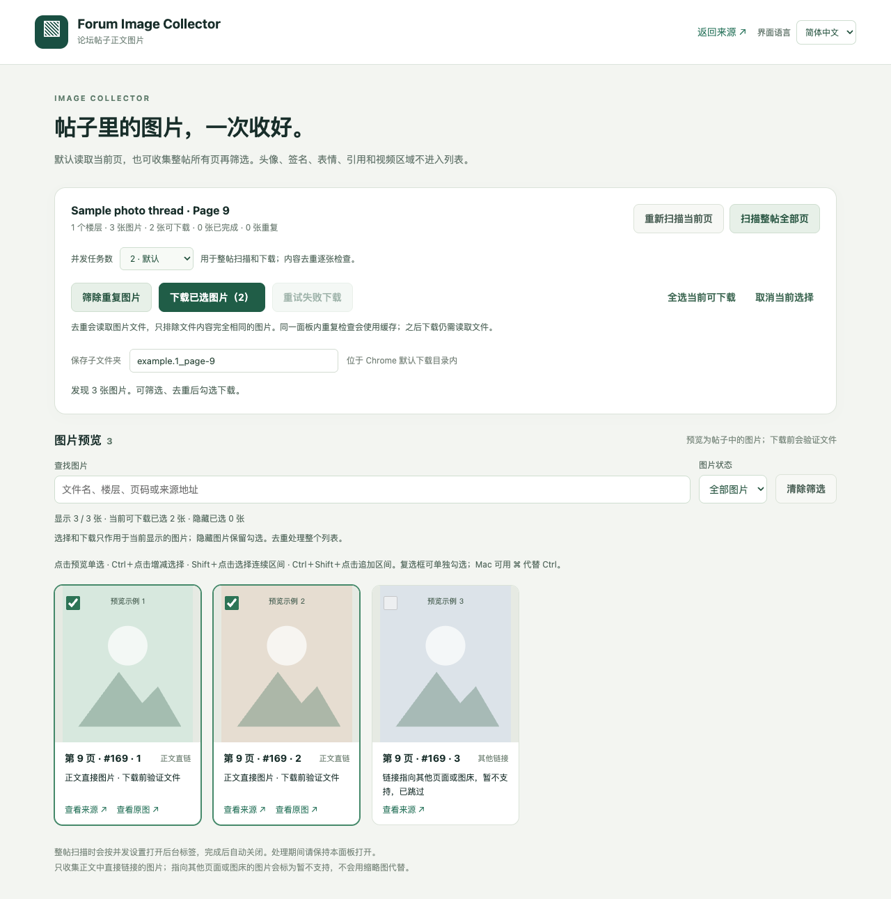

# Forum Image Collector

简体中文 · [English](README.en.md) · [常见问题](docs/TROUBLESHOOTING.md) · [发布指南](docs/PUBLISHING.md)

A local-first Chrome extension for collecting, previewing and downloading images linked directly in forum posts.

一个在浏览器本地运行的论坛帖子图片收集工具：先收集、预览和筛选，再下载。支持当前页、兼容论坛的整帖扫描、快捷多选、完全相同文件去重和可调并发。

**支持由页面结构决定，不绑定某个网站，也不保证任意网站都能使用。**



*截图来自实际界面与合成测试数据，不代表真实站点验证。界面支持简体中文和 English，可在右上角切换。*

## 功能

- 中英文界面：首次跟随浏览器语言，可手动切换并在本机记住选择；运行中的状态同步切换。

- 从已支持的帖子正文区域提取图片，排除头像、签名、表情、引用和常见视频/广告容器。
- 兼容 XenForo 分页结构的帖子可从第 1 页收集；暂停或失败后在同一面板续扫。
- 预览后勾选下载；Ctrl/Command 点击增减，Shift 选择区间，Ctrl/Command+Shift 追加区间。
- 按文件名、楼层、页码、来源地址或处理状态筛选；显示隐藏已选数量。
- 一键重试当前可见且已选的下载失败项，跳过已完成图片。
- 比较原文件 SHA-256，排除字节完全一致的副本；不会把视觉相似照片自动合并。
- 1～4 路并发，默认 2 路；内容去重逐张检查。
- 只在用户操作时申请所需 HTTPS 站点访问权限。无账号系统、遥测、远程代码或上传服务。

## 支持范围

| 页面类型 | 当前支持 | 限制 |
| --- | --- | --- |
| XenForo 风格论坛 | 当前页；兼容 `/threads/.../page-N` 和页码导航时支持整帖 | 主题或插件改变 DOM 时可能需适配 |
| phpBB 风格论坛 | `.post .postbody .content` 内已加载的图片 | 当前页，不自动翻页 |
| Discourse 风格论坛 | `article[data-post-id] .cooked` 内已加载的图片 | 不自动滚动加载整个话题，不读取尚未加载的帖子 |
| 正文图片直链 | HTTPS 的受支持图片扩展名或附件路径 | 文件下载前仍会检查 MIME、解码和尺寸 |

只收集正文里**直接链接**的图片。指向图片查看页、相册或其他图床的链接会标为“暂不支持”，扩展不针对特定网站编写解析模板，也不会用缩略图代替。论坛结构的适配细节见 [适配说明](docs/ADAPTERS.md)。

## 安装

需要 Chrome 120 或更新版本。其他 Chromium 浏览器可能兼容，尚未逐一验证。

1. 从仓库 Releases 下载 `forum-image-collector-v3.0.0.zip`，或下载源码，解压。
2. 打开 `chrome://extensions`，启用“开发者模式”。
3. 点击“加载已解压的扩展程序”，选择含 `manifest.json` 的 **extension** 文件夹。
4. 将 Forum Image Collector 固定到工具栏。

只使用扩展不需要 Node、npm 或 Python。它还不是 Chrome Web Store 上架包；GitHub 源码发布也不会自动安装扩展。

## 使用

右上角 **界面语言 / Language** 可随时切换简体中文和 English。首次使用时，中文浏览器显示中文，其余语言显示英文。选择仅保存在扩展本地；切换不会重置勾选、筛选或下载队列。来源标题、原文件名和保存路径保持原样。

1. 正常打开已登录、已加载的 HTTPS 帖子页，点击扩展图标。
2. 需要时点击“扫描整帖全部页”。浏览器可能询问访问该论坛的权限；拒绝时操作不会开始。
3. 可选“筛除重复图片”，再用复选框或快捷键筛选。
4. 按关键词和状态筛选，点击“下载已选图片”。需要访问新的图片 CDN 时，浏览器会另外请求该站点权限。

**筛选规则：** 勾选、全选、取消、Shift 连选、下载和失败重试只作用于当前显示的图片；隐藏图片保留选择。去重仍处理整个列表。操作期间锁定筛选条件，新扫描会清除筛选。下载失败后检查来源并点击“重试失败下载”。

保存到 Chrome 默认下载目录的 `帖子图片/` 子目录。下载期间保持面板打开。更新代码后在扩展管理页刷新，并重新打开面板。

去重需要先读取文件；缓存只保留指纹，正式下载还需要再次读取。缓存、选择状态与扫描进度随面板关闭而清除，不扫描磁盘历史下载。拒绝网络重定向，不将登录页、错误页或缩略图当作原图保存。

## 开发

使用 Node.js 22+ 和 Python 3.11+。扩展运行文件无需编译，开发依赖只用于测试。

```sh
npm ci --ignore-scripts
npm run verify
python3 -m unittest discover -s tests -p 'test_*.py'
python3 tools/package.py
```

Windows PowerShell 如限制脚本执行，可使用 `npm.cmd`。Windows 的 Python 命令可使用 `python`；Mac 可直接运行 `bash tools/mac-check.sh`。系统 Python 较旧时，用 `PYTHON_BIN` 指定已有的 Python 3.11+。构建结果位于 `dist/`，包括可安装扩展包与干净的源码包。

测试使用合成 HTML、示例域名和边界 API 替身，不请求真实网站。自动化通过不代表所有真实网站均兼容，当前没有生产站点的全流程性能基准。

## 仓库结构

```text
extension/       扩展运行源码与代码生成的图标
tests/           DOM、权限、异步流程和交互回归测试
tools/           检查与打包工具
docs/            适配、隐私、架构及发布说明
.github/         自动测试和 issue/PR 模板
```

准备上传仓库请看 [发布说明](docs/PUBLISHING.md)；修改前请看 [CONTRIBUTING.md](CONTRIBUTING.md)。

## 发布与后续方向

已配置跨平台 CI，以及手动触发、先验证后创建 Release 草稿的工作流。完整步骤见 [发布指南](docs/PUBLISHING.md)，实际验证范围见 [验证记录](docs/VALIDATION.md)。

后续可扩展关闭面板后的进度恢复、更多论坛分页适配及视觉相似去重。这些功能尚未实现。

## 隐私与使用边界

页面访问和图片读取直接发生在浏览器与用户选择的网站之间，网站仍能看到这些请求；这不是匿名下载工具。下载只用于你有权访问和保存的内容，不绕过登录、验证或访问限制。

权限细节见 [隐私说明](docs/PRIVACY.md)。问题反馈请使用合成示例，不附带 Cookie、签名链接、私人照片或未脱敏的网页截图。

## 关于这个项目

这个扩展的大部分代码是在 AI 编程助手的协助下完成的；需求、使用边界和测试验证由我负责。

## License

[MIT](LICENSE).
